# Drone Mapping of Vegetation Cover and Bare Ground on Grazed Rangeland near Moab, Utah

**Author:** Anamika Dristi, Ph.D.

This project maps green vegetation, dry vegetation or litter, and bare ground on a 0.5 ha grazed rangeland plot south of Moab, Utah, from a public USGS drone survey flown on 5 May 2023. The main input is a 5-band multispectral orthomosaic (blue, green, red, red edge, near infrared) with 1.2 cm pixels. A second camera (natural color, 0.77 cm), two structure-from-motion surface models and a drone lidar point cloud come from the same data release. I compare a simple index-threshold method with a random forest classifier. The random forest map gives 58.2% bare ground, 29.4% dry vegetation or litter and 12.2% green vegetation for the plot. On 22 spatially separate test blocks its overall accuracy is 96.5% (95% interval 95.6 to 97.3, kappa 0.95), against 84.4% (81.9 to 87.0, kappa 0.77) for the thresholds. These accuracy numbers are measured against labels that I made by a color rule on the second camera, not against field-labeled pixels, so they are a weaker form of validation. One real field check is available: a BLM AIM field plot measured five days before the flight lies inside the mosaic. It recorded 53.3% bare soil (95% interval 45.4 to 61.1). The random forest map gives 57.8% bare ground in the same 30 m radius circle, inside that interval. The threshold map gives 72.7%, outside it. Aggregated to 10 m Sentinel-2 pixels, drone green cover is only weakly related to Sentinel-2 NDVI (r = 0.42, n = 36), because the plot is small and uniform.

This is an independent analysis of public data. It is separate from my LSU dissertation datasets and uses none of them.

## Why it matters

- **Bare ground is a core rangeland indicator.** Bare ground is where raindrops hit soil directly, where runoff starts and where wind and water erosion begin. Land managers (BLM, NRCS, USDA-ARS, state agencies and ranches) track percent bare ground and percent plant cover to judge rangeland condition and to set grazing.
- **Link to water management.** Infiltration, runoff and sediment yield in rangeland hydrologic models depend on cover. Cover maps at 1 to 10 m are the kind of input that can inform curve numbers, cover factors and land use parameters in watershed models such as SWAT+.
- **Scale gap.** Field crews measure cover on a few transects. Satellites see 10 to 30 m pixels. A drone sees single grass plants. This project shows what each scale can and cannot tell at one site where all three exist for the same week.

## Study site

- Site 7 of the USGS survey at the NEON Moab site, San Juan County, Utah, about 40 km south of Moab. Center near 38.2065 N, 109.4207 W, elevation about 1,785 m.
- Ecological site: Semidesert Sandy Loam (Four-Wing Saltbush), from the BLM AIM record. The USGS metadata describes it as a grazed rangeland environment.
- Mosaic footprint: 72 m by 70 m (0.50 ha). Relief inside the plot is 1.6 m, mean slope 2.0%, sloping toward the north-northeast.

## Data sources

All data are public and were retrieved without accounts or API keys on 2026-11-23.

| Dataset | Provider and link | What was used | License |
|---|---|---|---|
| Drone multispectral orthomosaic and DSM | USGS ScienceBase, https://doi.org/10.5066/P9MMCJET (child item 64ef59e0d34e4b6d8ab72b8e) | `2023-05-05_Moab_Site7_Multi_Ortho_5band.tif` (764 MB), `2023-05-05_Moab_Site7_Multi_DSM.tif` | U.S. public domain |
| Drone natural color orthomosaic and DSM | Same release (child item 64ee43a8d34e4b6d8ab70f77) | `2023-05-05_Moab_Site7_RGB_Ortho_3band.tif` (275 MB), `2023-05-05_Moab_Site7_RGB_DSM.tif` | U.S. public domain |
| Drone lidar point cloud | Same release (child item 64ef6626d34e4b6d8ab72c45) | `2023-05-05_Moab_Site7_Lidar_PointCloud.las` (2.58 million points) | U.S. public domain |
| Ground control points | Same release (child item 65a70d1bd34e5af967a46842) | 6 surveyed targets at site 7 | U.S. public domain |
| Field plot (line-point intercept cover, heights) | BLM AIM TerrADat public feature service, https://services1.arcgis.com/KbxwQRRfWyEYLgp4/arcgis/rest/services/BLM_Natl_AIM_TerrADat_Hub/FeatureServer/0 | Plot `USGS_NEON2`, visited 2023-04-30, one record | U.S. public domain |
| Sentinel-2 L2A surface reflectance | Earth Search STAC on AWS, https://earth-search.aws.element84.com/v1 (collection `sentinel-2-l2a`) | Scenes `S2B_12SXH_20230429_0_L2A` and `S2B_12SXH_20230509_0_L2A`, bands B02, B03, B04, B08 and SCL, a 670 m by 680 m window | Copernicus Sentinel data, free and open |

Required attribution: Scholl, V.M., Burgess, M.A., Bauer, M.A., Brady, L.R., and Thurau, R.G., 2024, Uncrewed Aircraft Systems (UAS) natural color, multispectral, lidar, and hyperspectral remote sensing data products collected at dryland sites 40 km south of Moab, Utah in May 2023: U.S. Geological Survey data release, https://doi.org/10.5066/P9MMCJET. Sentinel-2: contains modified Copernicus Sentinel data (2023).

Sensor and flight details (from the USGS metadata and from the files):

| Item | Multispectral | Natural color | Lidar |
|---|---|---|---|
| Aircraft | DJI Matrice 600 Pro | Skydio X2D | DJI Matrice 600 Pro |
| Sensor | AgEagle MicaSense Altum-PT | Skydio X2D color camera | YellowScan Vx20-100 (905 nm) |
| Flight height above ground | 31 m | 15 m | 31 m |
| Flight date | 5 May 2023 | 5 May 2023 | 5 May 2023 |
| Bands | 475, 560, 668, 717, 842 nm (reflectance, 0 to 1) | red, green, blue (8-bit) | single return, 514 points per m2 |
| Ground sampling distance | 1.21 cm (DSM 2.42 cm) | 0.77 cm (DSM 1.55 cm) | not applicable |
| CRS | NAD83(2011) / UTM zone 12N, EPSG:6341, heights NAVD88 | same | same |
| Processing by USGS | Agisoft Metashape 1.8.0, 4 control and 2 check targets, check RMSE 0.04 / 0.18 / 1.35 cm (X / Y / Z) | same workflow | PPK corrected |

Notes on sources:

- The large drone files are not stored in this repository. `scripts/01_download_data.py` downloads them (about 1.2 GB). The small field record, the Sentinel-2 windows and the reference points are stored in `data/`.
- The data release has no labeled pixels and no per-pixel ground truth. The only field measurement of cover is the single BLM AIM plot.
- I looked for a drone dataset in Texas, Oklahoma or Louisiana with more than RGB and with field data, and did not find one. The USGS Texas drone release I found (Medina River, https://www.sciencebase.gov/catalog/item/63a0d2ddd34e0de3a1f27889) is RGB only with no field cover data, so I chose the Moab site.
- NEON flew its airborne sensors over this site in April 2023. I tried to list those files through the NEON data API, and the file listing returned "Access Denied" without an account token, so NEON data are not used here.
- NAIP imagery for this location on the keyless Earth Search catalog ends in September 2021 and sits in a requester-pays bucket, so it is not used.

## Methods

1. **Data QA** (`02_data_qa.py`). I read CRS, pixel size and no-data share for each raster. The natural color mosaic is averaged onto the 1.2 cm multispectral grid. The shift between the two cameras is measured by phase correlation in nine windows. Calibration tarps, ground control targets and gear are masked (neutral grey or white patches larger than 0.01 m2, plus a buffer). A sharpness map of 2 m cells checks for blur.
2. **Brightness banding.** The multispectral mosaic gets brighter and darker from row to row, because sunlight changed between the east-west flight lines. I divide each image row by its smoothed row median relative to the site median, with one gain for all five bands, so band ratios such as NDVI do not change.
3. **Vegetation indices** (`03_vegetation_indices.py`). NDVI, NDRE, SAVI and MSAVI need the near infrared bands. ExG, ExGR, VARI and GLI need only visible bands and show what an RGB-only drone could give. A soil redness index, (red - blue) / (red + blue), separates the red soil from grey plant material.
4. **Height** (`04_vegetation_height.py`). Height above ground is the surface minus a ground estimate from a morphological opening with a 1 m window. I do this for both structure-from-motion DSMs and for the lidar (highest point per 10 cm cell) and compare the three.
5. **Reference labels** (`05_reference_labels.py`). The labels come from a fixed color rule on the natural color camera, which is a different aircraft, flight and sensor from the classifier inputs. Only clear pixels get a label, and a point is kept only if its 3 by 3 pixel neighborhood has one label. The site is cut into 10 m blocks. 60% of blocks are for training and 40% for testing, chosen at random. Up to 3,000 training and 2,000 test points per class are drawn at random.
6. **Classification** (`06_classify.py`). Four classes: green vegetation, dry vegetation or litter, bare ground, shadow or other.
   - Index thresholds: shadow if NIR < 0.10, then green if NDVI is above its Otsu threshold (0.251), then bare if soil redness is above its Otsu threshold (0.380), else dry vegetation or litter. No training data are used.
   - Random forest: 150 trees on 15 inputs from the multispectral flight only (5 bands, NDVI, NDRE, MSAVI, ExG, redness, brightness, local texture of NIR and NDVI, local mean NDVI, height from the multispectral DSM).
   - A second random forest with only blue, green, red, ExG and redness shows what the visible bands alone can do.
7. **Accuracy** (`07_accuracy_assessment.py`). Confusion matrix, overall accuracy, user's and producer's accuracy, F1 and kappa on the test blocks. Intervals come from a block bootstrap (the 22 test blocks are resampled 2,000 times).
8. **Fractional cover** (`08_fractional_cover.py`). The class maps are aggregated to 1 m, 5 m and 10 m cells. Site cover is given with three kinds of uncertainty: spatial (bootstrap of 10 m cells), model (30 forests refit on resampled training blocks) and method (thresholds against random forest). The drone cover inside a 30 m radius circle around the BLM AIM plot center is compared with the field record.
9. **Scale comparison** (`09_scale_comparison.py`). Drone layers are averaged into the 10 m Sentinel-2 pixels that lie fully inside the mosaic (36 pixels) and compared with Sentinel-2 NDVI from 29 April and 9 May 2023.

## Results

All numbers come from the run of this code on 2026-11-23 and are saved in `outputs/tables/`.

### Data quality

| Check | Result |
|---|---|
| No-data pixels in the multispectral mosaic | 0% |
| Masked artifacts (tarps, targets, gear) | 0.39% of the area; analysis area 5,019 m2 |
| Shift between the two cameras | median 0.50 cm, largest 0.76 cm (less than one 1.2 cm pixel) |
| Row-to-row brightness gain, multispectral camera | 0.79 to 1.16 before correction, 0.98 to 1.02 after |
| Difference of that gain between the five bands | at most 0.03, so it is an illumination effect and not a change in the surface |
| Row-to-row brightness, natural color camera | 0.90 to 1.06 (mostly a drift of the blue channel) |
| Sharpness of 2 m cells relative to the median | lowest 0.76, 5th percentile 0.87; no blurred strip found |

The brightness banding is the main quality problem in this mosaic. The USGS metadata also reports strong lighting changes at site 7.

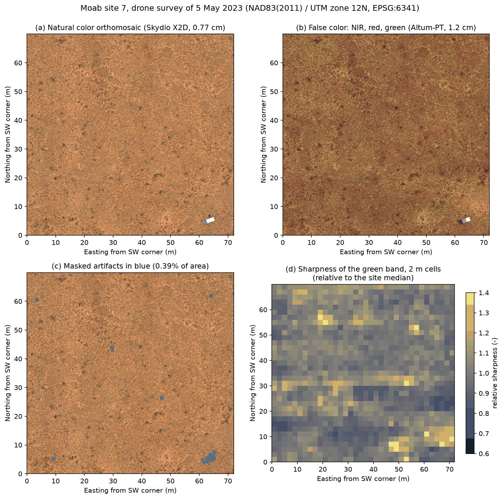

*Figure 1. Natural color mosaic, false color multispectral mosaic after the row gain, masked artifacts, and sharpness.*

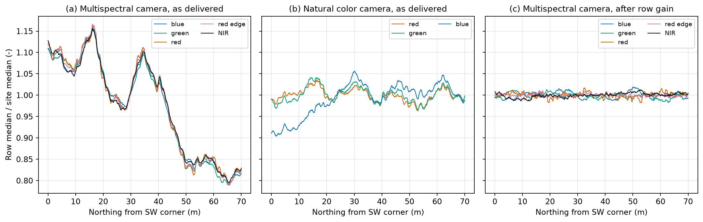

*Figure 2. Row median brightness relative to the site median, before and after the row gain.*

### Vegetation indices

| Index | 5th percentile | Median | 95th percentile | Otsu threshold | Rank correlation with NDVI |
|---|---|---|---|---|---|
| NDVI | 0.114 | 0.160 | 0.366 | 0.251 | 1.00 |
| NDRE | 0.062 | 0.091 | 0.174 | 0.125 | 0.92 |
| SAVI | 0.085 | 0.112 | 0.233 | 0.170 | 0.94 |
| MSAVI | 0.076 | 0.100 | 0.209 | 0.159 | 0.90 |
| ExG | -0.121 | -0.084 | 0.047 | -0.030 | 0.82 |
| ExGR | -0.560 | -0.478 | -0.193 | -0.365 | 0.81 |
| VARI | -0.364 | -0.319 | -0.132 | -0.238 | 0.82 |
| GLI | -0.094 | -0.065 | 0.035 | -0.025 | 0.82 |
| Soil redness | 0.274 | 0.439 | 0.488 | 0.380 | -0.69 |

The median NDVI of 0.16 is the red soil. Only about 5% of pixels have NDVI above 0.37. The visible-band indices rank pixels in nearly the same order as NDVI (rank correlation 0.81 to 0.82).

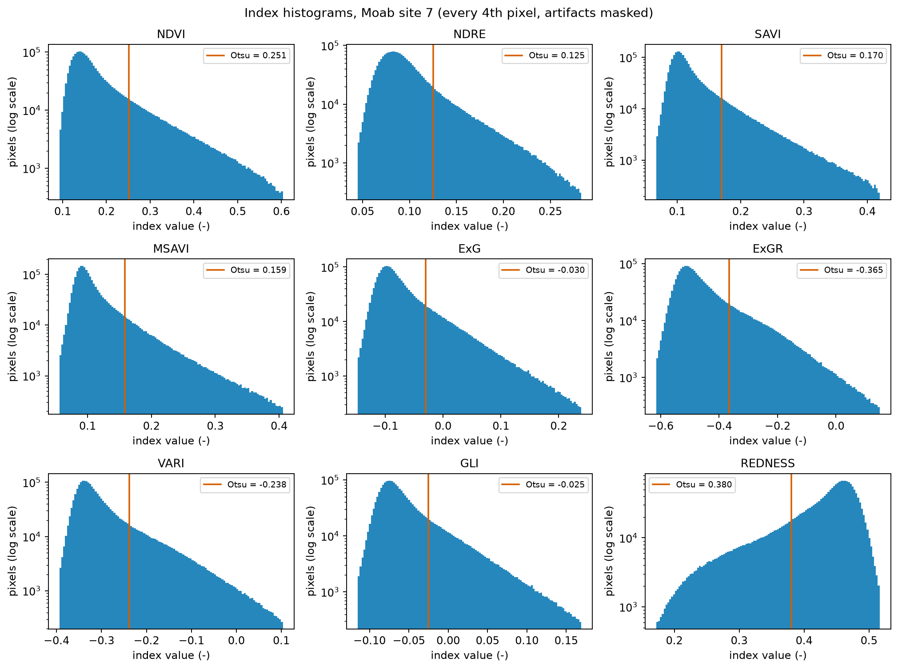

*Figure 3. Index histograms with Otsu thresholds.*

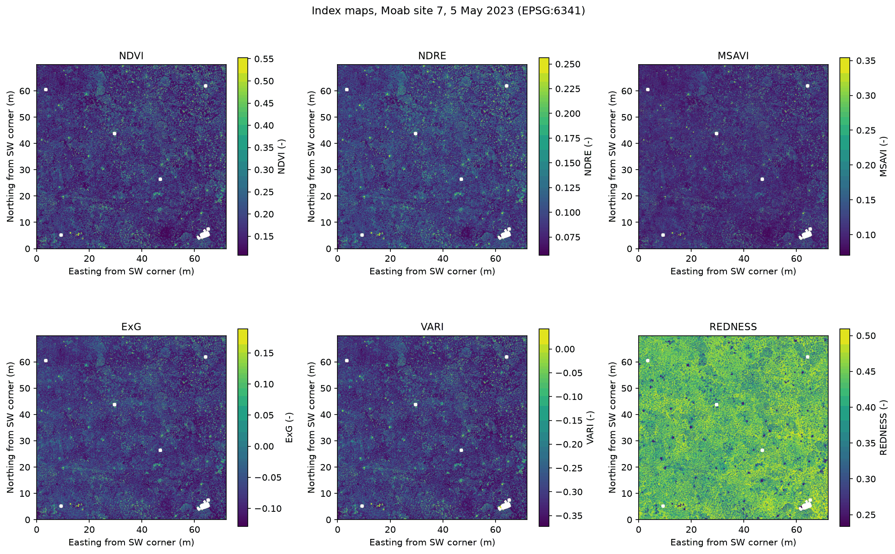

*Figure 4. Index maps.*

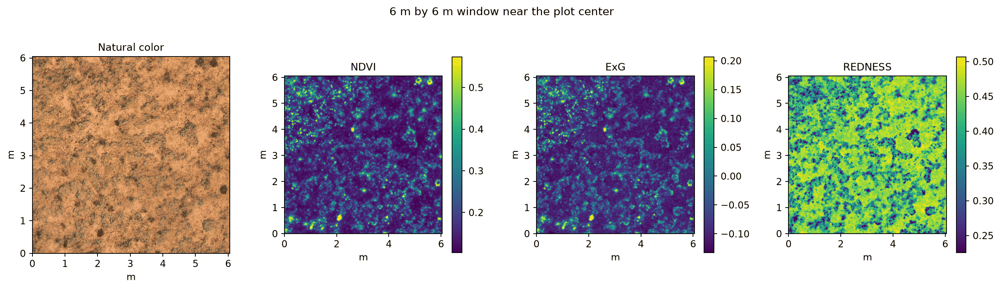

*Figure 5. A 6 m window: natural color, NDVI, ExG and soil redness.*

### Reference labels

| Class | Share of pixels labeled by the rule | Share kept after the 3 by 3 purity check | Training points | Test points |
|---|---|---|---|---|
| Green vegetation | 3.5% | 0.48% | 3,000 | 2,000 |
| Dry vegetation / litter | 7.2% | 0.36% | 3,000 | 2,000 |
| Bare ground | 24.2% | 1.84% | 3,000 | 2,000 |
| Shadow / other | 0.11% | 0.004% | 998 | 452 |
| Unlabeled (mixed or unclear) | 64.9% | 97.3% | 0 | 0 |

Only 2.7% of all pixels are clear enough to be reference pixels. The accuracy below is therefore accuracy on clear pixels. Most of the plot is mixed pixels at plant edges, for which no reference exists.

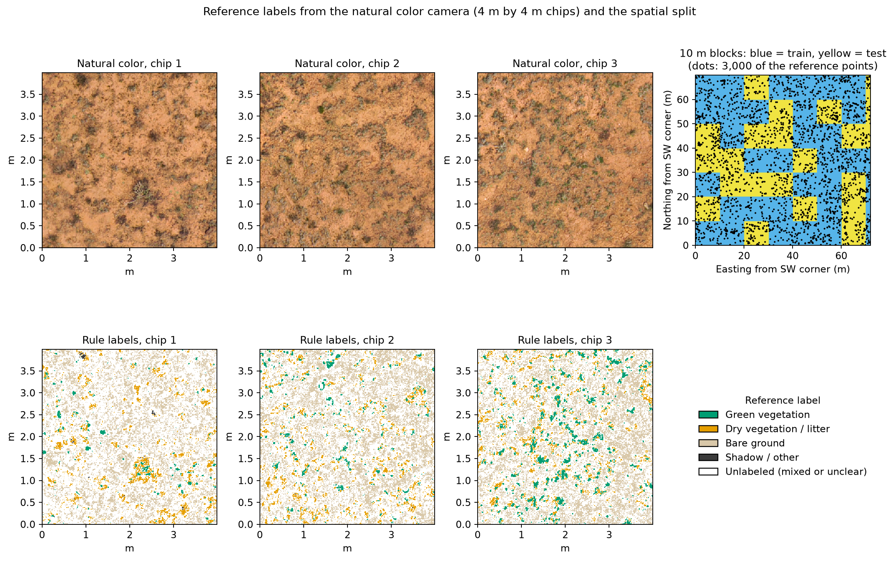

*Figure 6. Rule labels on three 4 m chips, and the 10 m training and test blocks.*

### Accuracy on the test blocks

6,452 test points in 22 blocks. Values in brackets are 95% block-bootstrap intervals.

| Metric | Index thresholds | Random forest | Random forest, visible bands only |
|---|---|---|---|
| Overall accuracy | 0.844 (0.819 to 0.870) | 0.965 (0.956 to 0.973) | 0.950 (0.940 to 0.960) |
| Overall accuracy weighted by class share | 0.949 (0.940 to 0.955) | 0.981 (0.977 to 0.984) | 0.972 (0.967 to 0.977) |
| Kappa | 0.775 (0.741 to 0.807) | 0.950 (0.936 to 0.962) | 0.930 (0.912 to 0.944) |
| Macro F1 | 0.702 (0.670 to 0.732) | 0.969 (0.962 to 0.975) | 0.956 (0.945 to 0.963) |

Per class (producer's accuracy / user's accuracy / F1):

| Class | Index thresholds | Random forest |
|---|---|---|
| Green vegetation | 0.982 / 0.699 / 0.817 | 0.948 / 0.945 / 0.946 |
| Dry vegetation / litter | 0.718 / 0.928 / 0.809 | 0.940 / 0.949 / 0.944 |
| Bare ground | 1.000 / 0.976 / 0.988 | 1.000 / 0.998 / 0.999 |
| Shadow / other | 0.106 / 1.000 / 0.192 | 0.998 / 0.976 / 0.987 |

- The random forest is better than the thresholds by 12.1 points of overall accuracy (95% interval 9.0 to 15.0).
- The threshold method calls too much green: 27% of the reference dry vegetation points are mapped as green. A single NDVI cut cannot separate dull green from grey plant material.
- Bare ground is easy for both methods at this site because the soil is red.
- The shadow class is tiny (0.25% of the map). Its reference label uses the multispectral brightness, because shadows moved between the two flights, so its accuracy is not independent and should not be quoted.
- Spatial 5-fold cross-validation over the blocks gives random forest overall accuracy of 0.956 to 0.971, in line with the single split.
- Soil redness is by far the most useful input (permutation importance 0.24). Height adds almost nothing (0.0005).
- The visible-band forest is nearly as accurate as the full forest. This is partly built into the test: the reference labels were made from visible color, so they favor visible bands.

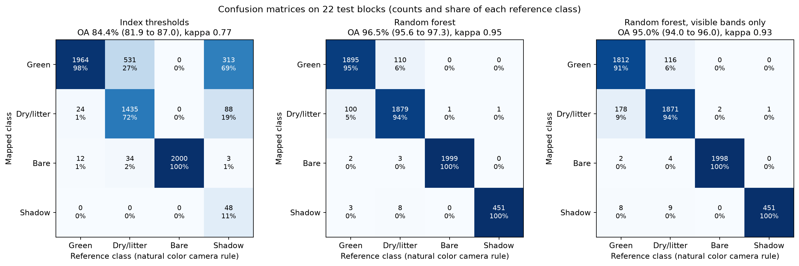

*Figure 7. Confusion matrices on the test blocks.*

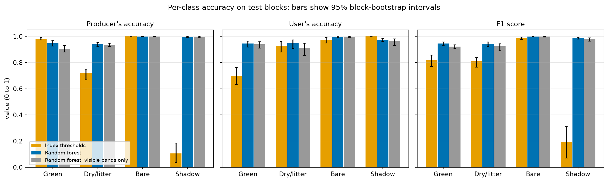

*Figure 8. Per-class producer's accuracy, user's accuracy and F1 with 95% intervals.*

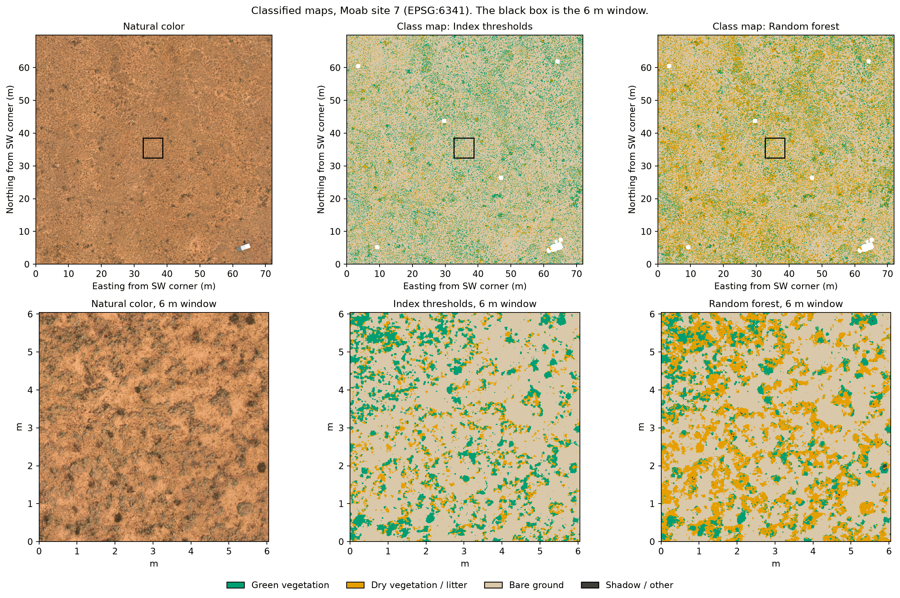

*Figure 9. Class maps from both methods for the plot and for a 6 m window.*

### Site cover and fractional cover

Site-level cover for the whole mosaic (percent of the analysis area):

| Class | Index thresholds | Random forest | Spatial 95% interval (random forest) | Range over 30 refit forests |
|---|---|---|---|---|
| Green vegetation | 16.2 | 12.2 | 11.1 to 12.9 | 8.3 to 18.1 |
| Dry vegetation / litter | 11.1 | 29.4 | 28.4 to 30.7 | 20.7 to 33.2 |
| Bare ground | 72.7 | 58.2 | 56.8 to 59.7 | 54.7 to 62.1 |
| Shadow / other | 0.01 | 0.25 | 0.19 to 0.29 | 0.20 to 0.29 |

- The spatial interval is narrow because the whole plot was mapped.
- The larger uncertainty is in the classifier. When the forest is refit on resampled training blocks, bare ground moves by about 4 points either way and the split between green and dry vegetation moves by about 5 to 6 points.
- The two methods differ by 14.6 points of bare ground. The choice of method matters more than any of the intervals.

Random forest fractional cover by cell size (mean, and 5th to 95th percentile of cells):

| Cell size | Cells | Green vegetation % | Dry vegetation / litter % | Bare ground % |
|---|---|---|---|---|
| 1 m | 4,885 | 12.1 (3.6 to 25.1) | 29.5 (14.6 to 48.4) | 58.1 (33.4 to 78.4) |
| 5 m | 196 | 12.0 (6.6 to 18.0) | 29.5 (21.5 to 39.5) | 58.2 (47.7 to 68.8) |
| 10 m | 42 | 12.0 (7.6 to 16.7) | 29.5 (23.2 to 35.6) | 58.2 (51.5 to 66.5) |

The mean does not change with cell size, as expected. The spread shrinks fast: bare ground ranges from 33 to 78% between 1 m cells and only from 52 to 66% between 10 m cells. A 10 m pixel hides most of the patchiness.

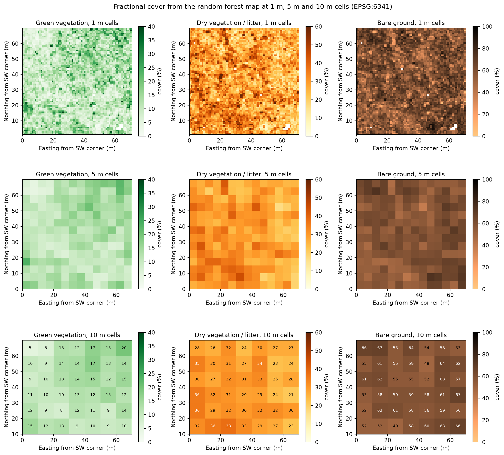

*Figure 10. Fractional cover from the random forest map at 1 m, 5 m and 10 m cells.*

### Field check against the BLM AIM plot

The AIM plot `USGS_NEON2` was read on 30 April 2023 with 150 line-point intercept points. Its center is 36 m east and 29 m north of the south-west corner of the mosaic. I assume the standard AIM layout (three 25 m transects inside a 30 m radius circle), because the public record does not give the transect lines.

| Quantity | Field (95% binomial interval) | Drone, random forest | Drone, index thresholds |
|---|---|---|---|
| Bare ground % | 53.3 (45.4 to 61.1) | 57.8 | 72.7 |
| Plant canopy + litter % | 46.7 (38.9 to 54.6) | 42.0 | 27.3 |

- The random forest map is within 4.4 points of the field value and inside the field interval. The threshold map is 19.3 points too bare.
- The field record has 30.0% plant canopy, 16.0% litter and 0.7% rock as the first hit. It does not record greenness, so the drone split between green (11.6%) and dry (30.4%) cannot be checked against it.
- This is one plot. It checks the plot-level totals, not the position of single pixels.

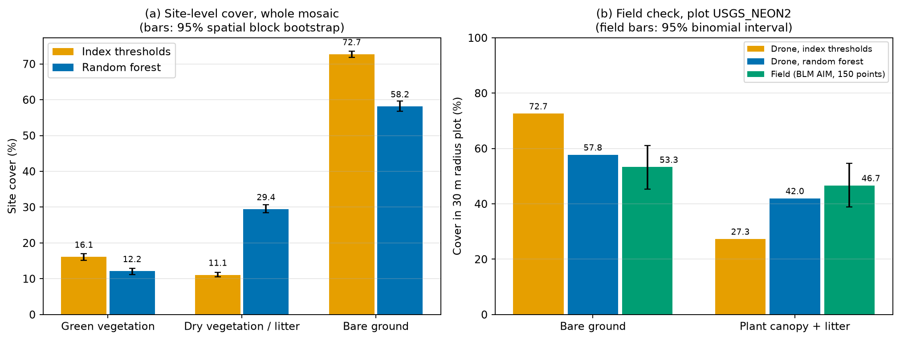

*Figure 11. Site cover by method, and the field check.*

### Height and structure

| Source (10 cm cells) | Mean height (cm) | 95th percentile (cm) | 99th percentile (cm) | Area above 10 cm (%) |
|---|---|---|---|---|
| SfM, multispectral flight | 2.6 | 7.0 | 16.3 | 2.3 |
| SfM, natural color flight | 1.9 | 5.0 | 9.8 | 1.0 |
| Lidar, highest point per cell | 2.2 | 5.5 | 10.9 | 1.2 |

Height by class, for 10 cm cells that are at least 90% one class (mean height in cm):

| Class | SfM multispectral | SfM natural color | Lidar |
|---|---|---|---|
| Green vegetation | 11.6 | 8.2 | 9.6 |
| Dry vegetation / litter | 5.4 | 3.8 | 4.0 |
| Bare ground | 1.0 | 0.8 | 1.1 |

- All three sources agree on the ordering: green plants are tallest, dry material is low, bare ground is flat. This is an independent sign that the classes are real surface types.
- The field crew measured an average of 10.0 cm for herbaceous plants and 31.3 cm for shrubs. The drone means for green cells (8 to 12 cm) are in the same range.
- The three height maps agree only moderately cell by cell (Pearson r 0.77 to 0.84; cells above 10 cm overlap with an intersection over union of 0.40 to 0.41). At plant heights of a few centimetres, height maps are near their noise level.
- The lidar provider classified 99.6% of points as ground. On vegetation this short, lidar adds little beyond the photogrammetry.

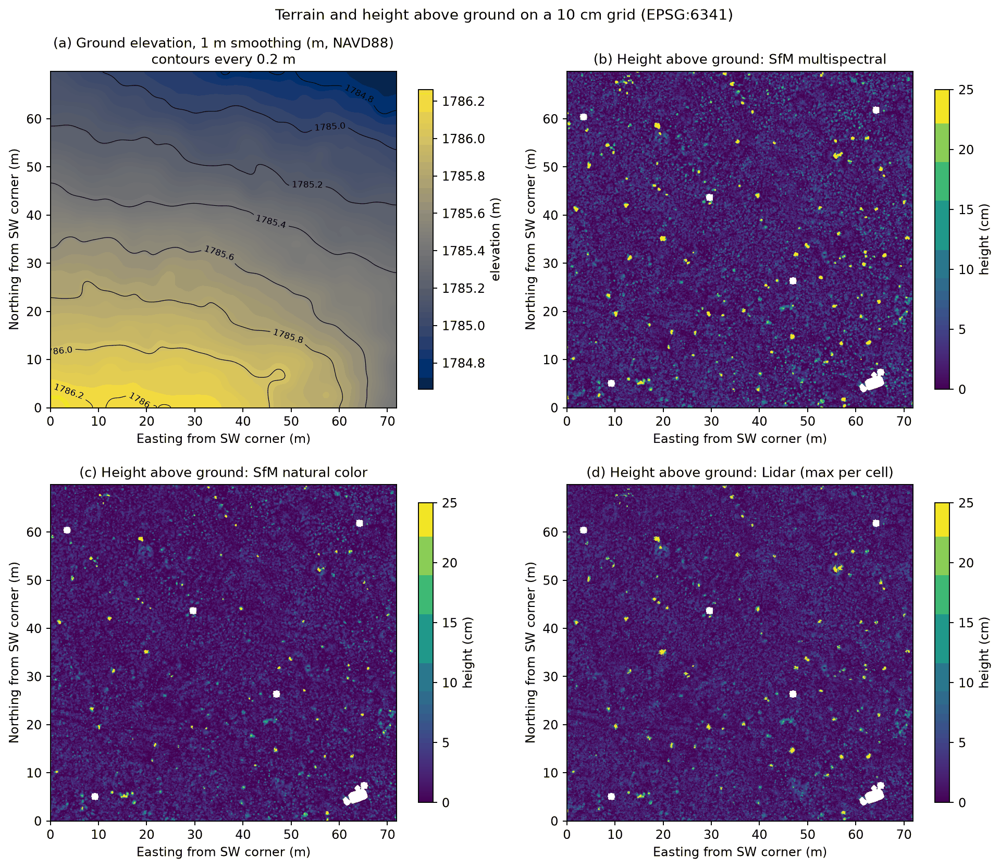

*Figure 12. Ground elevation and height above ground from the three sources.*

### Scale comparison with Sentinel-2

36 Sentinel-2 pixels (10 m) lie fully inside the mosaic. Both scenes are cloud free over the site (scene class "bare soil" for every pixel in the window).

| Relation (n = 36 pixels) | 29 April 2023 | 9 May 2023 | Mean of both dates |
|---|---|---|---|
| Drone green cover % against Sentinel-2 NDVI, Pearson r | 0.17 (p = 0.32) | 0.41 (p = 0.012) | 0.42 (p = 0.011) |
| Drone green + dry cover % against Sentinel-2 NDVI | 0.43 | 0.49 | 0.62 |
| Drone bare ground % against Sentinel-2 NDVI | -0.44 | -0.49 | -0.62 |
| Drone NDVI at 10 m against Sentinel-2 NDVI | 0.32 | 0.48 | 0.55 |

- Regression for the mean of both dates: green cover % = -23.6 + 216 x NDVI, slope 95% interval 53 to 379, RMSE 2.1 points of cover. The slope interval is very wide, so this line is not a usable calibration.
- Site means: drone NDVI 0.181; Sentinel-2 NDVI 0.150 on 29 April and 0.175 on 9 May. The drone reflectance is lower than Sentinel-2 in both bands (red 0.181 against 0.217 to 0.228; NIR 0.261 against 0.309).
- The Sentinel-2 NDVI differs between the 36 pixels by a standard deviation of only 0.005 to 0.007. The two Sentinel-2 dates, 10 days apart, correlate with each other across these pixels at only r = 0.09. So most of the pixel-to-pixel variation that the satellite sees inside this plot is noise.
- Within the drone data the relation is strong: green cover against drone NDVI at 10 m has r = 0.91. The signal exists at 10 m, and the satellite cannot resolve it over a range of 5 to 20% green cover in 36 pixels.
- If the Sentinel-2 grid is shifted by up to 10 m in any direction, the correlation with drone green cover ranges from -0.12 to 0.67. A shift of 7.5 m south gives the best agreement. Sentinel-2 geolocation error of several metres is therefore enough to change the answer at this plot size.

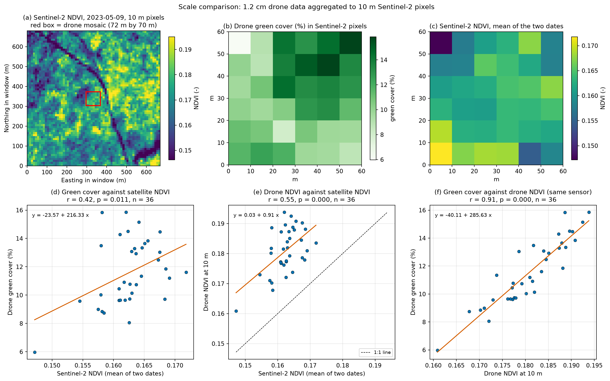

*Figure 13. Sentinel-2 NDVI around the plot, drone green cover in Sentinel-2 pixels, and scatter plots.*

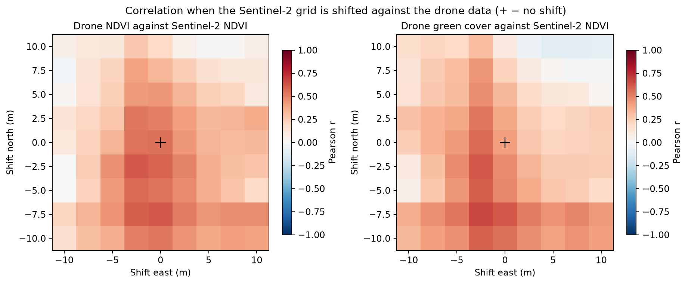

*Figure 14. Correlation when the Sentinel-2 grid is shifted against the drone data.*

## Rangeland and water management interpretation

- **Bare ground is the dominant cover.** About 58% of the plot is bare (55 to 62% across refit models; 53% in the field record). The BLM record also gives a soil aggregate stability rating of 1.5 on a scale of 1 to 6, which is low. A site with this much bare, weakly aggregated soil will shed water as runoff in intense storms and is exposed to wind erosion.
- **Bare ground is connected.** 30% of the plot is in 10 cm cells that are at least 90% bare. 35% of that solid bare area sits in connected patches larger than 1 m2 (10.7% of the plot), and the largest single patch is 47 m2. Connected bare patches are the paths along which runoff and sediment can move without meeting a plant. The largest patches are near the south edge about 50 m from the west side, in the north-west part and along the east side (Figure 15).
- **Terrain.** The plot slopes about 2% to the north-northeast, so overland flow would run from the south edge toward the north edge. Bare ground at 5 m cells is not related to slope (Spearman r = -0.03) and only weakly to elevation (r = -0.16, p = 0.03). Green cover is somewhat higher at lower elevation (r = -0.29, p < 0.001), which fits water collecting downslope, but relief is only 1.6 m and I would not read much into it.
- **Cover varies at the scale of plants, not of the plot.** Between 1 m cells bare ground ranges from 33 to 78%; between 10 m cells only from 52 to 66%. Management decisions for a pasture need the plot mean, and that is stable. Erosion process studies need the 1 m pattern, and only the drone gives it.
- **Most plant cover is not green in early May.** Dry vegetation and litter (29%) cover more than twice the area of green vegetation (12%). The field record lists mostly warm-season perennial grasses (15.3% of 20.7% perennial grass cover), which are still dormant in early May. Dry cover protects soil from raindrop impact just as green cover does, but greenness indices such as NDVI do not see it. A monitoring program that uses a greenness index alone would see only the 12% green cover and would miss the 29% of the plot that is protected by dry material.
- **What the scale comparison means for monitoring.** One drone plot of 0.5 ha gives a good plot-level cover value, but it holds too few and too similar satellite pixels to calibrate Sentinel-2. To calibrate a satellite product, drone plots need to be placed across a wide range of cover (for example 10 to 20 plots from 5% to 80% green cover), each at least 60 m across, and bare ground or total cover is a better target than green cover on dry rangeland.

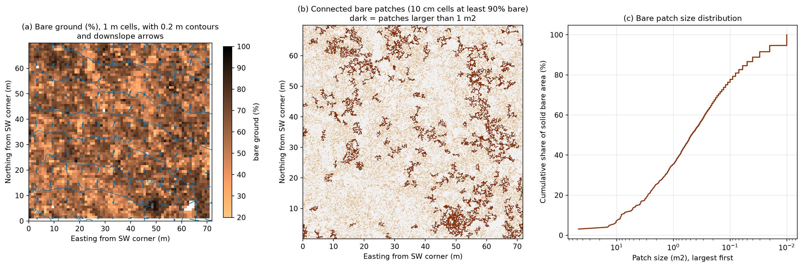

*Figure 15. Bare ground at 1 m with contours and downslope arrows, connected bare patches, and the patch size distribution.*

## Limitations

- **Validation is weaker than field data.** There are no field-labeled pixels. The reference labels come from a color rule that I wrote for the natural color camera. They are independent of the classifier in sensor, aircraft and flight, but both cameras see the same visible colors, so the classes are defined by color and not by a botanist. The reported accuracy is agreement between two sensors on the clearest 2.7% of pixels. Accuracy on mixed pixels is unknown and is certainly lower.
- **The label rule sets the class boundaries.** The thresholds in the rule were chosen by eye from histograms and image chips. Different thresholds would move the boundary between dry vegetation and bare ground, and so the cover totals. I did not test this sensitivity.
- **One field plot.** The BLM AIM comparison is one plot of 150 points with a 95% interval of about 8 points either way. It supports the plot totals of the random forest map and nothing finer. The transect positions are assumed from the standard AIM layout.
- **Shadow class.** Its reference label uses the multispectral brightness, so its accuracy is not independent. It covers 0.25% of the map and does not affect the totals.
- **Biological soil crust and rock are not mapped.** The field record shows no crust and 0.7% rock at this plot, so this matters little here, but the method would confuse dark crust with dry vegetation elsewhere.
- **Brightness banding.** The row gain assumes that the true row median brightness is the same across the plot. A real north-south gradient in soil brightness would be removed with it. Indices built from band ratios are not affected.
- **One date, one site.** 5 May 2023, one 0.5 ha plot in one ecological site. Nothing here shows change over time or transfer to other sites. A classifier trained here will not work on a site with different soil color without new training data.
- **Scale comparison.** Only 36 Sentinel-2 pixels with a narrow range of cover, and scenes 6 days before and 4 days after the flight. The weak correlation says that this design cannot calibrate the satellite. It does not say that Sentinel-2 cannot map cover on rangeland.
- **Datum.** The drone data are in NAD83(2011) and Sentinel-2 in WGS 84. The two differ by about 1 to 2 m here, and the coordinate transformation used may treat them as the same. This is small against a 10 m pixel and is covered by the shift test.
- **Height.** Plants are 5 to 30 cm tall and the height maps have errors of a few centimetres, so height is shown as a supporting layer only.
- **No hydrologic model.** The runoff and erosion statements are interpretation of cover and terrain. No infiltration, runoff or erosion was measured or modeled.

## How to run

```bash
python -m venv .venv
source .venv/bin/activate
pip install -r requirements.txt
bash scripts/run_all.sh          # first run downloads about 1.2 GB
```

The analysis steps take about 5 to 6 minutes on a laptop after the download. Raw downloads go to `data/raw/`, which is git-ignored. Set `DRONE_DATA_DIR=/path` to keep them somewhere else. About 4 GB of free disk space and 8 GB of memory are needed. See `docs/RUN_GUIDE.md` for step-by-step instructions.

Outputs:

- `outputs/figures/`: 15 PNG figures.
- `outputs/tables/`: CSV tables for every number in this README.
- `outputs/maps/`: the two class maps at 1.2 cm (GeoTIFF, EPSG:6341; 1 green, 2 dry vegetation or litter, 3 bare, 4 shadow or other, 0 masked) and 1 m fractional cover (3 bands: green, dry, bare, in percent). They open directly in QGIS or ArcGIS Pro. I did not run those programs for this project.

## References

- Scholl, V.M., Burgess, M.A., Bauer, M.A., Brady, L.R., and Thurau, R.G., 2024, Uncrewed Aircraft Systems (UAS) natural color, multispectral, lidar, and hyperspectral remote sensing data products collected at dryland sites 40 km south of Moab, Utah in May 2023: U.S. Geological Survey data release, https://doi.org/10.5066/P9MMCJET.
- Over, J.R., Ritchie, A.C., Kranenburg, C.J., and others, 2021, Processing coastal imagery with Agisoft Metashape Professional Edition, version 1.6, Structure from motion workflow documentation: USGS Open-File Report 2021-1039, https://doi.org/10.3133/ofr20211039.
- Herrick, J.E., Van Zee, J.W., McCord, S.E., and others, 2017, Monitoring manual for grassland, shrubland, and savanna ecosystems, 2nd ed., Volume I: Core methods: USDA-ARS Jornada Experimental Range.
- Otsu, N., 1979, A threshold selection method from gray-level histograms: IEEE Transactions on Systems, Man, and Cybernetics, 9(1), 62-66.
- Breiman, L., 2001, Random forests: Machine Learning, 45, 5-32.
- Woebbecke, D.M., Meyer, G.E., Von Bargen, K., and Mortensen, D.A., 1995, Color indices for weed identification under various soil, residue, and lighting conditions: Transactions of the ASAE, 38(1), 259-269.
- Gitelson, A.A., Kaufman, Y.J., Stark, R., and Rundquist, D., 2002, Novel algorithms for remote estimation of vegetation fraction: Remote Sensing of Environment, 80(1), 76-87.
- Qi, J., Chehbouni, A., Huete, A.R., Kerr, Y.H., and Sorooshian, S., 1994, A modified soil adjusted vegetation index: Remote Sensing of Environment, 48(2), 119-126.
- Olofsson, P., Foody, G.M., Herold, M., and others, 2014, Good practices for estimating area and assessing accuracy of land change: Remote Sensing of Environment, 148, 42-57.
- Congalton, R.G., 1991, A review of assessing the accuracy of classifications of remotely sensed data: Remote Sensing of Environment, 37(1), 35-46.

## License

Code: MIT License (see `LICENSE`). The USGS and BLM data are in the U.S. public domain. Sentinel-2 data are free and open under the Copernicus data policy.

## Contact

Contact: anamikadristi@gmail.com
